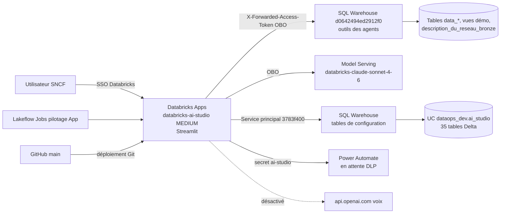
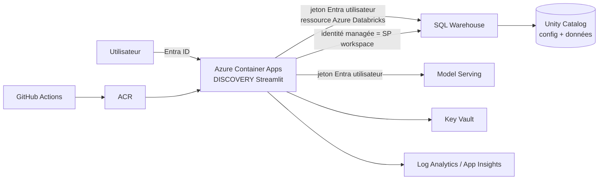
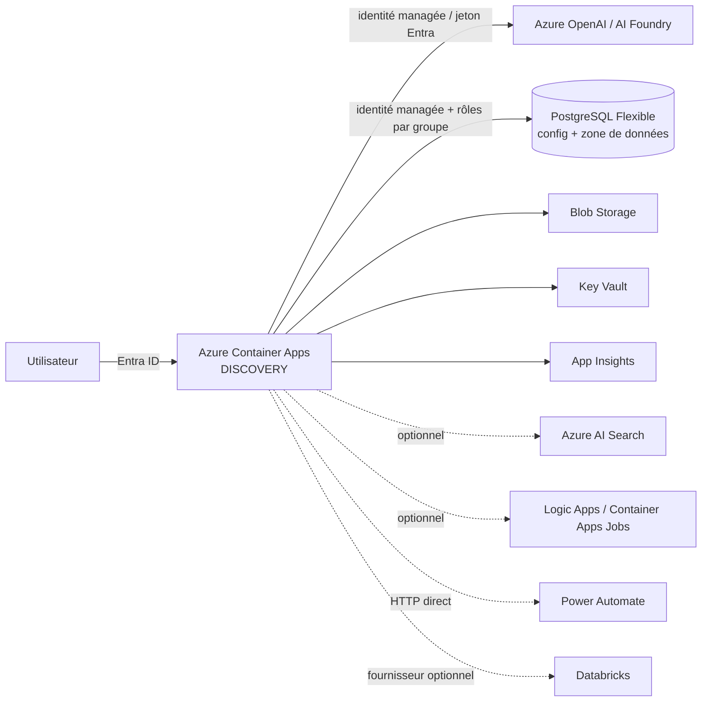
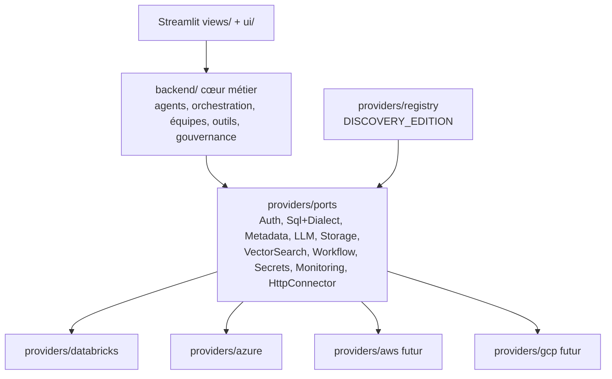

# DISCOVERY — Stratégie de migration vers Microsoft Azure

Version 0.1 — 22/11/2026 — **à valider**. Analyse et conception uniquement : aucun développement, aucune ressource Azure créée.

Annexe : `DISCOVERY_Migration_Azure.xlsx` (14 feuilles : synthèse, audit fichier par fichier, inventaire, mapping, architectures, providers, informations requises, ressources, coûts, risques, plan, tâches, structure, informations).

Sources : code du dépôt `migration_ai/apps/databricks-ai-studio` (analyse statique de tous les fichiers), API Databricks (Apps, Unity Catalog, SQL Warehouses), comptages SQL du 22/11/2026. Les coûts sont des ordres de grandeur non sourcés, à valider avec Azure Pricing Calculator et le contrat SNCF Réseau. Les points marqués « à vérifier en POC » ne sont pas démontrés.

---

## 1. Synthèse

* Le couplage à Databricks est **concentré** : le SDK `databricks` n'est importé que dans 3 fichiers (`backend/security.py`, `backend/sql_client.py`, `backend/model_client.py`). 8 fichiers actifs appellent directement une API Databricks.
* Sur 90 fichiers Python hors tests (13 723 lignes) : 57 indépendants (6 928 lignes, ~50 %), 23 à adapter pour le SQL (5 485 lignes), 10 à adapter fortement (1 310 lignes, dont 3 du code SaaS inactif).
* Le contrat interne existe déjà : `SqlClient.query()` renvoie `{columns, rows, truncated, types}` et `ModelClient.chat()` utilise le format OpenAI. Ce sont les deux points de branchement principaux.
* La principale difficulté n'est pas l'hébergement mais : (1) la **délégation d'identité** (OBO Unity Catalog), (2) le **dialecte SQL Spark** des 12 fichiers actifs qui écrivent en base, (3) la **requalification des agents** si le modèle Claude est remplacé.
* Recommandation : découpler (étape 2), puis **Architecture A** (hybride) en premier jalon (22 j-h), puis **B** par incréments (LLM, puis PostgreSQL). **C** découle de l'architecture en ports. Charge totale estimée : **66 j-h**.

---

## 2. Architecture AS-IS



### 2.1 Couches du code

| Couche | Fichiers | Lignes | Couplage Databricks |
| --- | --- | --- | --- |
| `views/` (pages Streamlit) | 15 | 2 310 | `transformation.py` (`w.tables.list`) seulement |
| `ui/` (composants, état) | 17 | 1 764 | `state.py` (clients, en-têtes), `layout.py` (`current_user.me`) |
| `backend/` (cœur métier) | 34 | 6 708 | `security`, `sql_client`, `model_client` ; SQL Spark dans les repositories |
| `tools/` (outils des agents) | 21 | 2 786 | `job_tools` (Jobs API), `hakim_transformation_tools` (`tables.list`), SQL UC dans 10 outils |
| `database/` | 2 + 3 SQL | 60 | DDL Delta / Unity Catalog |
| `tests/` | 42 | 4 790 | Majoritairement sur des doubles (fakes) : réutilisables |

### 2.2 Composants indépendants (réutilisables tels quels)

Runtime d'agent (`agent_runtime`), orchestrateur et délégations (`orchestrator`, `mentions`), personas, équipes (`teams`), garde-fous HakimAI (`hakim_guard`, `hakim_plan`), `sql_guard`, règles de `policy_engine` et de `transformation` (hors SQL), rendu des graphiques, cartes, rapports, export Excel (bibliothèque standard), avatars, thème, toutes les pages sauf `transformation.py`.

### 2.3 Points d'adaptation (preuves dans le code)

| Point | Fichiers | Constat |
| --- | --- | --- |
| Identité utilisateur | `backend/security.py`, `ui/state.py`, `ui/layout.py` | En-têtes `X-Forwarded-Access-Token` / `X-Forwarded-Email` propres à Databricks Apps ; refus explicite si absents (à conserver) |
| Exécution SQL | `backend/sql_client.py` | API Statement Execution (`/api/2.0/sql/statements`) |
| Modèles | `backend/model_client.py` | `/serving-endpoints/{e}/invocations` et liste `/api/2.0/serving-endpoints` |
| Configuration | `backend/config.py`, `app.yaml` | `DATABRICKS_WAREHOUSE_ID`, `DATABRICKS_APP_NAME`, noms à 3 niveaux `catalog.schema.table` |
| SQL applicatif | 12 fichiers actifs (`agent_repository`, `team_repository`, `publication`, `agent_contracts`, `flux`, `transformation`, `policy_engine`, `hakim_tools`, `hakim_write_tools`, `flow_tools`, `dashboard_data`, `views/hakim`) | 45 `current_timestamp()`, 17 `INSERT`, 15 `UPDATE`, 2 `MERGE INTO`, 2 `REPLACE WHERE` (Delta), identifiants entre accents graves (hors code SaaS inactif) |
| Métadonnées UC | `tools/uc_tools`, `backend/tool_builder`, `backend/tool_designer`, `views/transformation`, `tools/hakim_transformation_tools` | `SHOW TABLES`, `DESCRIBE TABLE EXTENDED`, `information_schema`, `approx_count_distinct`, `tables.list` |
| Outils propres à UC | `tools/custom_tools`, `tools/http_tools` | `uc_function`, connexions UC + `http_request()` (0 outil/connexion en service) |
| Jobs | `tools/job_tools.py` | `/api/2.1/jobs/runs/get`, `runs/list` |
| Secrets | `tools/power_automate.py` | Variable alimentée par la ressource secret de l'App (code neutre) |

À noter : `backend/saas/` (3 fichiers couplés) est toujours présent alors que le SaaS a été retiré le 19/11 : à exclure de la migration.

---

## 3. Inventaire des ressources Databricks

Seules les ressources prouvées par le code ou la configuration sont retenues comme utilisées.

| ID | Ressource | Identifiant réel | Usage (preuve) | Caractère |
| --- | --- | --- | --- | --- |
| R01 | Databricks Apps | `databricks-ai-studio` (MEDIUM, déploiement Git `main`) | `app.yaml`, `config.running_in_databricks_app` | Obligatoire (édition Databricks) |
| R02 | Autorisation utilisateur OBO | scopes `sql`, `model-serving`, `vector-search` | `security.resolve_user`, `ui/state` | Obligatoire |
| R03 | Service principal de l'App | `3783f400-adb1-4afc-bec8-bddb42de2e11` | `security.app_client`, `ui/state.repository`, `flow_tools` | Obligatoire |
| R04 | SQL Warehouse | `d0642494ed2912f0` 2X-Small serverless PRO | `sql_client` + 12 fichiers SQL applicatif + 10 outils | Obligatoire |
| R05 | Model Serving | `databricks-claude-sonnet-4-6` (15 agents, 40 versions) | `model_client`, `ui/state.chat_endpoints` | Obligatoire |
| R06 | Schéma UC applicatif | `dataops_dev.ai_studio` (46 objets, 35 tables applicatives < 3 Mo) | `database/*.sql`, `settings.table()` | Obligatoire |
| R07 | Données métier | `data_*` (~8 100 lignes), vues `data_demo_sc_*` -> `sncf_dqv3_silver`, `description_du_reseau_bronze` | `config.data_scope`, `knowledge_tables` | Obligatoire pour les agents existants |
| R08 | Métadonnées UC | `SHOW TABLES`, `DESCRIBE`, `tables.list` | `uc_tools`, `tool_builder`, `tool_designer`, Transformation | Obligatoire |
| R09 | Fonctions UC | type d'outil `uc_function` | `custom_tools` | Optionnel (0 outil) |
| R10 | Connexions UC + `http_request` | — | `custom_tools.http_call`, `http_tools` | Optionnel (0 connexion utilisable) |
| R11 | Secret | `ai-studio/power-automate-smart-office-url` | `power_automate` | Optionnel |
| R12 | Jobs API | runs/get, runs/list | `job_tools` | Optionnel |
| R13 | Jobs d'exploitation | `666668106479037`, `91206249238387` + `app_power_log` | Hors code de l'App | Optionnel (FinOps) |
| R14 | Vector Search | aucun index appelé | Scope déclaré, aucun appel | **Non utilisé** |
| R15 | System Tables | `billing.usage`, `access.table_lineage` | Outils au statut planifié | **Non utilisé** |
| R16 | Genie Spaces, Knowledge Assistants, Volumes | — | Aucune référence | **Non utilisé** |
| R17 | API identité | `current_user.me` | `ui/layout`, mode local | Obligatoire (faible) |
| R18 | Déploiement Git | GitHub `haimensoussi/migration_ai` | API Apps deployments | Obligatoire (édition Databricks) |
| R19 | Sorties non Databricks | api.openai.com (voix désactivée), Power Automate, CARTO, jsDelivr | `voice`, `power_automate`, `map_view`, `hakim_report_tools` | Optionnel |

Usage mesuré (13-22/11/2026) : 2 utilisateurs distincts, 61 conversations, 722 messages, 258 appels d'outils, 299 189 jetons ; 15 agents dont 8 publiés, 4 équipes, 23 outils dont 4 planifiés.

---

## 4. Mapping Databricks vers Azure (résumé)

Détail complet (fichiers, modifications, coûts, risques) : feuille « Mapping Azure ».

| Ressource | Service Azure cible | Équivalence | Type de remplacement | Complexité | Priorité |
| --- | --- | --- | --- | --- | --- |
| Databricks Apps | Azure Container Apps + ACR | Élevée | Direct (conteneur) | Faible | P1 |
| OBO utilisateur | Authentification intégrée ACA / MSAL Entra ID ; jeton Entra vers Azure Databricks (A) | Moyenne | Développement Python (AuthProvider) | Moyenne | P1 |
| SP de l'App | Identité managée | Élevée | Direct | Faible | P1 |
| Secret | Key Vault + référence de secret ACA | Élevée | Direct (même variable) | Faible | P1 |
| Déploiement Git | GitHub Actions (OIDC) -> ACR -> ACA | Élevée | Direct | Faible | P1 |
| Model Serving | Azure OpenAI / AI Foundry | Format : élevée ; comportement : moyenne | Adaptateur mince + requalification | Faible / Moyenne | P2 |
| Warehouse (configuration) | PostgreSQL Flexible Server | Moyenne | Développement (SqlProvider + SqlDialect) | Moyenne | P2 |
| Schéma `ai_studio` | Schéma PostgreSQL | Élevée | DDL + reprise (< 3 Mo) | Faible | P2 |
| Métadonnées UC | `information_schema` PostgreSQL | Moyenne | Développement (MetadataProvider) | Moyenne | P2 |
| Données `data_*` | PostgreSQL ou Databricks conservé comme fournisseur | Moyenne | Copie / provider | Faible | P3 |
| Jobs d'exploitation | Règles d'échelle ACA + planification | Élevée | Suppression du pilotage maison | Faible | P3 |
| Supervision | Tables conservées + Application Insights | Élevée | Complément | Faible | P3 |
| Fonctions UC | Fonctions PostgreSQL ou capacité désactivée | Partielle | Optionnel | Faible | P4 |
| Connexions UC + `http_request` | Connecteur HTTP Python + Key Vault (APIM optionnel) | Moyenne | Développement | Moyenne | P4 |
| Jobs API | Logic Apps / Container Apps Jobs / Data Factory | Partielle | Adaptateur optionnel | Moyenne | P4 |
| Voix (OpenAI direct) | Azure OpenAI gpt-realtime | Moyenne | Changement d'URL/auth (à vérifier par région) | Moyenne | P4 |
| Vector Search | Azure AI Search | — | Prévu, non implémenté | — | P5 |
| System Tables | Cost Management, Log Analytics, Purview | — | Non requis | — | P5 |

---

## 5. Architectures cibles

### 5.1 Architecture A — Azure hybride



* Principe : seul l'hébergement change. Azure Databricks accepte les jetons Entra ID émis pour sa ressource : la délégation utilisateur et les droits Unity Catalog sont **conservés** (à vérifier en POC : obtention et rafraîchissement du jeton dans ACA).
* Code : AuthProvider Entra, Dockerfile, hôte du workspace en variable, identité managée pour le compte de l'App. Le reste est inchangé.
* Avantages : délai court (22 j-h), aucune donnée déplacée, aucune requalification. Limite : Databricks reste obligatoire.

### 5.2 Architecture B — Azure Native



* Principe : tous les ports ont une implémentation Azure ; Databricks devient un fournisseur de données optionnel.
* Point critique : l'OBO Unity Catalog disparaît pour les données hébergées sur Azure. À remplacer par des rôles PostgreSQL associés aux groupes Entra et du Row Level Security, ou par le maintien de Databricks comme fournisseur de données.
* Requalification obligatoire des 15 agents, de HakimAI et des copilotes si le modèle change (Claude disponible via AI Foundry : à vérifier selon contrat et région).

### 5.3 Architecture C — Multi-cloud



* PostgreSQL est le dénominateur commun du repository sur Azure, AWS (RDS/Aurora) et GCP (Cloud SQL) : un seul adaptateur SQL.
* Le format OpenAI est le dénominateur commun LLM (Azure OpenAI, Databricks, Vertex compatible ; Bedrock via adaptateur).
* Cloud additionnel : ~10-15 j-h par cloud (estimation à affiner à l'étape 10).

---

## 6. Informations nécessaires

Détail : feuille « Informations requises ».

| Information | Statut | Valeur connue |
| --- | --- | --- |
| Volumétrie applicative | Disponible | 35 tables < 3 Mo ; 722 messages ; 40 versions d'agents |
| Agents et exécutions | Disponible | 15 agents (8 publiés), 4 équipes, 299 189 jetons en 9 jours |
| Utilisateurs actuels | Disponible | 2 distincts ; cible : inconnue (humain) |
| Volumétrie métier | Disponible (partiel) | `data_*` ~8 100 lignes ; `description_du_reseau_bronze` à mesurer |
| Modèles Azure disponibles, quotas | Collectable automatiquement (après accès abonnement) | — |
| Configuration réseau du workspace | Collectable (partiel) + humain | — |
| Abonnement, Resource Group, région | Intervention humaine | — |
| Entra ID (application, consentement Azure Databricks, groupes) | Intervention humaine | — |
| Réseau et sécurité, classification des données | Intervention humaine | Connu : DNS sortant restreint, DLP Power Platform |
| Permissions Azure | Intervention humaine | Contributor sur le RG, administration des rôles, AcrPush, Key Vault Secrets Officer |
| Stockage documentaire, recherche vectorielle | Intervention humaine | Aucun besoin actuel |
| Budget, SLA/PRA, contrat Claude sur Azure | Intervention humaine | — |

---

## 7. Architecture du code multi-cloud

### 7.1 Ports

| Port | Remplace | Databricks | Azure | Contrat commun |
| --- | --- | --- | --- | --- |
| AuthProvider | `backend/security.py`, `ui/state._headers` | En-têtes Apps | ACA Entra / MSAL | `UserIdentity` + jeton par ressource |
| SqlProvider + SqlDialect | `backend/sql_client.py` | Statement Execution | PostgreSQL (psycopg) | `query() -> {columns, rows, truncated, types}` (inchangé) |
| RepositoryProvider | repositories (12 fichiers SQL actifs) | Delta | PostgreSQL | Méthodes métier inchangées, SQL via SqlDialect |
| MetadataProvider | `uc_tools`, `tool_builder`, `tool_designer`, Transformation | Unity Catalog | `information_schema` | `list_tables`, `describe_table`, `profile` |
| LLMProvider | `backend/model_client.py` | Model Serving | Azure OpenAI | `chat(...)`, `list_chat_endpoints()` (inchangés) |
| StorageProvider | — (exports en mémoire) | Volumes | Blob | put/get/list |
| VectorSearchProvider | — | Vector Search | AI Search | prévu |
| WorkflowProvider | `tools/job_tools.py` | Jobs | Logic Apps / ACA Jobs | `get_run`, `list_runs` (optionnel) |
| SecretsProvider | `os.environ` | Ressource secret | Key Vault | `get(nom)` |
| MonitoringProvider | — (tables conservées) | Tables | App Insights | traces, métriques |
| HttpConnectorProvider | `custom_tools.http_call` | Connexion UC + `http_request` | urllib + Key Vault | `call(...)` avec validation humaine |

### 7.2 Règles

* Le cœur (`backend/`, `tools/`, `views/`, `ui/` sauf `state.py`) n'importe **aucun** SDK cloud ; contrôle automatique dans les tests.
* Sélection par `DISCOVERY_EDITION` (`databricks` | `azure`) et surcharge possible par port (`DISCOVERY_LLM_PROVIDER`, ...), ce qui permet l'hybride A (Auth Azure + SQL/LLM Databricks).
* Capacités déclarées par fournisseur (ex. `uc_function`, `http_request`, `jobs`) : les fonctionnalités absentes sont masquées, jamais simulées.
* La consigne de dialecte SQL injectée dans les prompts des agents dépend du fournisseur SQL actif.
* Une seule suite de tests de contrat par port, exécutée contre les doubles, Databricks et Azure.
* Même version de Streamlit épinglée dans les deux éditions (Apps impose `< 1.45`).

### 7.3 Nouvelle structure du projet

```
apps/databricks-ai-studio/
  app.py, views/, ui/            conservés (ui/state.py passe par le registre)
  backend/                       cœur métier, sans dépendance cloud
  tools/                         conservés (ctx.workspace -> ctx.metadata / ctx.workflow)
  providers/
    ports.py, registry.py
    dialects/  spark.py, postgres.py
    databricks/ auth_apps.py, sql_warehouse.py, model_serving.py, uc_metadata.py, jobs.py
    azure/      auth_entra.py, postgres.py, azure_openai.py, blob.py, keyvault.py, appinsights.py
    common/     env_secrets.py, http_connector.py, fakes.py
  database/  schema.sql (Delta), postgres/ (DDL + reprise)
  app.yaml                       conservé à la racine (Databricks Apps)
  Dockerfile, deploy/azure/      Bicep, .env.example
  deploy/aws/, deploy/gcp/       squelettes (étape 10)
  requirements.txt + requirements-databricks.txt + requirements-azure.txt
  tests/contract/
```

Le nom `providers/` est retenu plutôt que `platform/`, qui masquerait le module standard Python `platform`.

---

## 8. Stratégie de migration

| Étape | Prérequis | Livrables | Charge (j-h) | Critères de validation |
| --- | --- | --- | --- | --- |
| 1. Audit des dépendances | Accès dépôt/workspace | Ce dossier + Excel, informations complétées | 2 | Inventaire validé |
| 2. Découplage de l'hébergement | Stratégie validée | Ports + providers Databricks (code actuel déplacé) | 8 | Suite de tests existante verte ; aucun import `databricks` hors `providers/databricks` ; App Databricks sans régression |
| 3. Déploiement sur ACA (hybride) | Abonnement, Entra, réseau | Instance ACA sur Databricks | 8 | Requête SQL exécutée sous l'identité de l'utilisateur (vérifiée dans l'historique) ; chat OK |
| 4. Validation hybride | Étape 3 | PV de recette | 4 | 100 % des cas OK ; droits UC identiques |
| 5. Azure OpenAI | Quotas | Agents requalifiés | 10 | Score d'évaluation >= référence Claude (seuil à valider) |
| 6. Tables vers PostgreSQL | Serveur PG | Repository PG + reprise | 14 | Comptages identiques ; tests verts sur Spark et PG |
| 7. Autres services | Étape 6 | Metadata, Secrets, Monitoring, HTTP, données | 10 | Outils d'exploration équivalents |
| 8. Équivalence fonctionnelle | Étapes 5-7 | PV d'équivalence | 4 | Écarts documentés et acceptés |
| 9. Indépendance Databricks | Étape 8 | Attestation | 2 | Fonctionne sans `databricks-sdk` ni accès réseau Databricks |
| 10. Portabilité AWS/GCP | Étape 9 | Guide de portage | 4 | Adaptateurs chiffrés, tests de contrat réutilisables |
| **Total** | | | **66** | |

38 tâches détaillées (responsable, dépendances) : feuille « Tâches ». L'édition Databricks reste opérationnelle à chaque étape (critère de non-régression de l'étape 2 rejoué à chaque livraison).

---

## 9. Ressources Azure à provisionner (après validation)

| Ressource | A | B | SKU indicatif |
| --- | --- | --- | --- |
| Resource Group, VNet (selon RSSI) | Oui | Oui | — |
| Container Apps Environment + App | Oui | Oui | Consumption, 1 vCPU / 2 Gio |
| Container Registry | Oui | Oui | Basic |
| Identité managée user-assigned | Oui | Oui | — |
| Enregistrement d'application Entra ID | Oui | Oui | — |
| Key Vault | Oui | Oui | Standard |
| Log Analytics + Application Insights | Oui | Oui | Pay-as-you-go |
| PostgreSQL Flexible Server | Non | Oui | B1ms/B2s (POC), D2ds + HA (prod) |
| Azure OpenAI / AI Foundry | Non | Oui | Standard régional UE si exigé |
| Storage Account | Optionnel | Oui | Standard |
| AI Search, Logic Apps, Front Door/WAF, NAT | Optionnel | Optionnel | — |

## 10. Estimation des coûts (indicative, €/mois)

| Poste | A | B POC | B production |
| --- | --- | --- | --- |
| Container Apps | 30-90 | 30-90 | 150-300 |
| PostgreSQL | — | 20-60 | 250-450 |
| Azure OpenAI (jetons) | — | < 20 | 100-1 500 |
| Supervision, registre, coffre, stockage | 15-40 | 20-45 | 75-215 |
| Réseau, WAF, AI Search (optionnels) | 0-70 | 0-70 | 70-800 |
| **Total Azure** | **50-200** | **70-280** | **650-3 200** |

A : le calcul Databricks Apps (MEDIUM) disparaît ; warehouse et jetons Databricks inchangés. Fourchettes non sourcées : à valider.

## 11. Risques principaux

| ID | Risque | Impact | Mitigation |
| --- | --- | --- | --- |
| RK01 | Jeton Entra -> Azure Databricks non obtenu/rafraîchi dans ACA | Élevé | POC en étape 3 ; jamais de repli silencieux sur l'identité de l'App |
| RK03 | Changement de modèle dégradant les agents | Élevé | Jeu d'évaluation de référence ; Claude via Foundry si possible |
| RK04 | Dialecte SQL, y compris le SQL généré par les agents | Moyen | SqlDialect, tests de contrat, consigne de dialecte dans les prompts |
| RK05 | Perte des droits fins UC en Azure natif | Élevé | Rôles PG par groupe Entra + RLS, ou Databricks fournisseur de données |
| RK06/07 | Réseau SNCF et autorisation RSSI | Élevé | Dossier sécurité dès l'étape 1 ; A minimise le déplacement de données |
| RK08 | Double maintenance | Moyen | Cœur unique, CI sur les deux éditions |

14 risques détaillés : feuille « Risques ».

## 12. Décisions attendues

1. Validation de la trajectoire A puis B, et de la priorité donnée au découplage (étape 2).
2. Modèle cible sur Azure : Azure OpenAI (requalification) ou Claude via AI Foundry.
3. Données métier en B : copie PostgreSQL ou Databricks conservé comme fournisseur.
4. Fourniture des informations humaines (section 6) et lancement du dossier RSSI.
5. Retrait de `backend/saas/` avant le découplage.
